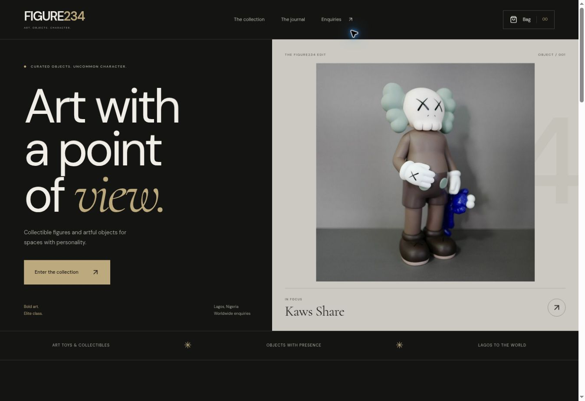

# Figure234



A gallery-style React storefront for collectible figures and artful objects. The redesign retains the dark palette, warm gold accents, existing public Sanity catalogue and WhatsApp enquiry workflow.

## Development

```sh
npm ci
npm run dev
npm run build
```

Vite produces `dist/`. Existing Vercel hosting can continue using the build script and output directory. Relative asset paths also support static subdirectory previews.

## Visitor flows

- Home shows actual artwork and selected pieces.
- The collection supports categories, search, price sorting and clear empty/error states.
- Product details expose size and colour options on every device.
- The enquiry bag supports distinct variants, quantities, removal, an indicative subtotal and browser-local persistence.
- Enquiries prepare correctly encoded WhatsApp drafts for the visitor to review and send. No order, reservation or message is automatically submitted.
- Contact form details stay in component memory while editing; only the bag is saved in local storage.
- Native dialogs provide focus containment and Escape dismissal; reduced-motion preferences are respected.

## CMS and fallback

The existing public Sanity project and dataset remain unchanged. Identical product records are consolidated for display by name, image and price while merging their size/colour options. The source records are not modified.

A verified four-piece snapshot provides an immediately browsable collection while the live request runs, and remains available if the CMS is unreachable or disallows the preview origin. A visible collection-preview notice asks visitors to confirm current availability. A successful live response replaces the snapshot, including a genuinely empty catalogue.

To refresh the snapshot and its local images from Sanity:

```sh
npm run catalogue:snapshot
npm run build
```

Snapshot prices are indicative; the team confirms final prices and delivery before any order. The original public CMS must permit production origins for live refreshes; preview access failed during QA, and the snapshot path was validated.

## Validation — 2026-10-30

- Production Vite build and Git whitespace checks pass.
- Snapshot refresh reads the existing CMS and saves four unique pieces with images.
- Browser-tested search, ascending price order, colour selection, bag quantity/subtotal, removal/empty state, refresh persistence, draft encoding and enquiry editing.
- Desktop and 390px mobile layouts reviewed without horizontal overflow; a mobile headline wrap found during QA was corrected.
- No message or order was sent.

Design references: free browsing of Landdding, Footer Design and EasyUI. Existing dependencies and source artwork are reused; no paid templates or builders are required.
